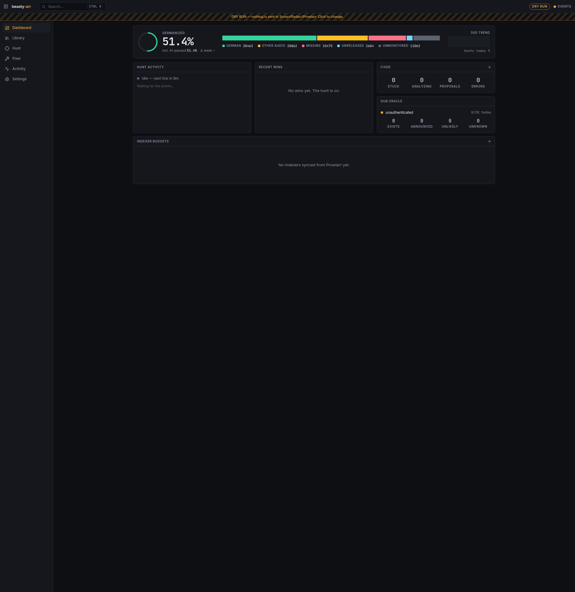

# beasty-arr


Finds the German dub for series and movies already managed by Sonarr and Radarr. beasty-arr keeps searching after the initial release window, while a dry-run mode lets you inspect every decision first.



## What it does

- Hunts existing non-German files for later German upgrades.
- Tracks indexer budgets before automatic searches.
- Uses an AI oracle to pause titles that have no German dub.
- Repairs stuck import-queue items with validation and confidence gates.
- Exposes a live dashboard, status endpoint, and manual Missing workspace.

Dry-run still performs library reads and planning. Explicit Oracle rechecks and Fixer analysis
can call AI while dry-run is enabled. Commands already accepted by an Arr can finish after
dry-run is turned on. Ambiguous command responses hold targets until acceptance is reconciled.

Fixer auto-run and Run all retry failed analyses after a cooldown starting at 15 minutes,
doubling up to six hours. Provider usage limits pause new Fixer analyses for one hour.
Auto-apply reanalyzes eligible saved proposals against current queue and library evidence before
applying them, even with auto-run off. Failed applications appear in the queue with their error
and a reanalysis/retry action. Manual review remains required below the configured confidence
thresholds or when no usable import candidates are available.

The Fixer does the check a person would do by hand. Before the AI runs, it inspects the real files
with ffprobe (duration, embedded title, every audio and subtitle stream including untagged German
tracks) and asks the arr to parse the release name without grab history. The AI can read subtitle
dialogue, folder listings, and NFO ids, and look up TMDb/TVDB titles and runtimes. Every proposal
states what the file actually is and why. Imports wait for review when the AI cannot confirm the
identity, when the release year, runtime, or independent parse contradicts the target, when the
file could not be inspected, or when it would lower the resolution without adding German audio.
Removals wait when they would throw away German audio the library lacks, when they would discard
a German file the arr scores above the library copy or whose German track the arr's labels missed,
when a "different work" verdict has no backing from the release year, runtime, or independent
parse, or when they would search for German the library already has. Downloads are checked against
the movie or series they were grabbed for, not the one the arr's queue re-maps them to by title;
when the two differ, an import waits for review. An audio track counts as German when its language tag or its title says so; when the two disagree,
the Fixer weighs the release name and other observations before deciding whether an import is safe. A removal is not held when the
candidate is a lower source than the library file at the same resolution (a WEB-DL against a remux), a file ffprobe rejects as invalid
does not count as possibly German, and a removal that asks for a new search although the library already has German is corrected
instead of held. A PROPER or REPACK counts as an upgrade only when it does not lower the custom-format score. Each analysis keeps its
tool results and the model's reasoning in the AI trace. An AI attempt that produces no output for `PI_STALL_TIMEOUT_MS` (default five
minutes) is aborted and retried within the inference time limit.

File inspection needs `FIXER_MEDIA_PATH_MAP` (for example `/data=/arr-data`) and the media share
mounted read-only at the mapped path. Without it, every import and removal waits for review.
Only one apply, removal, or ignore runs per download at a time; an overlapping request gets HTTP 409.

Season packs are handled as one download: the Fixer merges Sonarr's per-episode queue rows,
decides file by file which episodes are missing or upgrades, imports those together, and removes
verified non-upgrade leftovers and samples from the client without blocklisting.

Version 0.5.2 stores the queued episode set on each Fixer analysis; 0.5.1 added SQLite indexes for
recovery lookups. Startup applies the migrations; keep a pre-upgrade database backup.

For an unconfigured local start, copy `.env.example`, run `pnpm build`, then
`NODE_ENV=production pnpm start`. Optional integrations are omitted in the template.
Supply both the URL and key for each integration through your secret manager.
See [HANDOFF.md](HANDOFF.md) for current behavior and operator acceptance work.

## Security

Fastify serves the self-contained German legal pages at `/impressum` and `/datenschutz`,
and English versions at `/legal-notice` and `/privacy`, including trailing-slash variants.
They work without JavaScript, app assets or API calls, and carry noindex and strict CSP
headers. Exempt exactly these paths from the external sign-in gate. Every app page links
to all four pages. Bilingual content lives in `src/server/legal/content.ts`; a test
checks that every rendered page is free of unresolved placeholders.
See [test/README.md](test/README.md) for checks.

The application intentionally has no user login or API-key guard; every API route is reachable by
clients that can reach the service. Connected arr keys are still never returned by any endpoint,
and webhook callbacks use a dedicated capability token. Put the deployment behind a trusted network
or an external access-control layer if exposure requirements change.

## Development

```sh
pnpm dev
```

That single command starts API + Vite through Portless and injects the dev connection settings from
the `beasty-arr` Infisical project. It also opens a local Kubernetes port-forward so the budget
controller can read Prowlarr. Open the `.localhost` URL printed by Portless. Local development is
hard-locked to dry-run: it performs real library reads and hunt planning, but refuses to send commands
or mutations to Sonarr or Radarr. Set `SONARR_EXTERNAL_URL` and `RADARR_EXTERNAL_URL` to the
browser-reachable arr origins to show direct title links in the library. Use `pnpm check` for the
full local quality suite.

Runs on Node 24, Fastify 5, SQLite (Drizzle), React 19 + Vite. Deployed to the homelab cluster via
GitHub Actions on `arc-beasty-arr` → `ghcr.io/beastyrabbit/beasty-arr` → Flux. Publishing a `v*`
release tag is the deployment: Flux image automation commits the new image tag and digest to kub-homelab
`cluster/homelab/apps/media/beasty-arr/helmrelease.yaml`. Do not edit that pin by hand; fix a bad
release forward with a new tag.
Deployments should set `SONARR_EXTERNAL_URL` and `RADARR_EXTERNAL_URL` to the HTTPS origins users
open in their browsers. These public URLs contain no API keys and are separate from the internal arr
connection URLs.

Container publication uses the encrypted `GHCR_PUBLISH_TOKEN` repository secret when present,
falling back to `GITHUB_TOKEN` for packages that grant the repository Actions access.

## Telemetry

Umami 3 and GlitchTip are optional and enabled only with `NODE_ENV=production`.
`pnpm dev` never initializes telemetry, even if Infisical supplies production values.
Set `UMAMI_URL`, `UMAMI_WEBSITE_ID`, and `UMAMI_DOMAINS` together for analytics,
and `GLITCHTIP_DSN` for errors.
`GLITCHTIP_ENVIRONMENT` defaults to `production`. Each integration stays off when
its configuration is absent or invalid. No consent banner is needed for this private
tool behind Pangolin SSO, and no user identity is assigned.

The server supplies only public values through uncached `GET /api/client-config`.
This keeps the image independent of its deployment and lets the browser fetch its
configuration without rewriting HTML. `UMAMI_DOMAINS` is a required comma-separated
hostname allowlist used by Umami's `data-domains`. The app never infers domains from
request headers. Analytics stays disabled if any of the three Umami values is missing.
Use an explicit loopback allowlist for local fixture tests.
Browser automation is excluded unless a loopback fixture sets
`window.__BEASTY_TELEMETRY_TEST__ = true`. Umami also honors Do Not Track; keep its
server bot filtering enabled.

Umami receives pageviews, SPA navigation, built-in LCP/INP/CLS/FCP/TTFB performance
measurements, and small events about completed actions. Its inspected `script.js`
supports `data-website-id`, `data-domains`, `data-exclude-search`, `data-exclude-hash`,
`data-performance`, `data-before-send`, and `data-do-not-track`. The saved public scripts
in `test/fixtures` are the evidence for these attributes. History hooks track TanStack
Router navigation automatically; the browser test verifies two pageviews without
manual duplicate tracking. For pageviews and events, page titles are fixed to
`beasty-arr`, dynamic IDs are replaced with route placeholders, and query strings,
fragments and referrers' search terms are removed. Outbound-link events contain only
the destination hostname.

Replay and heatmaps use the Umami website settings. Website `beasty-arr` has both
enabled at 100% sampling, `maskLevel: strict`, a 300000 ms maximum duration, and
`blockSelector: [data-telemetry-block]`. Keep those settings when recreating the website.
`recorder.js` loads from `UMAMI_URL` and sends settings requests and recordings directly
there, preserving the browser's client context. It bypasses `beforeSend`: replay Meta
`href` and heatmap click/scroll `url` fields include the app route's path and query,
including media search terms and title IDs. The app's browser routes carry no secrets,
so these route URLs contain no credentials. There is no recorder relay to scrub them.
Settings, portaled dialogs, Fixer analysis/history, AI evidence, external Arr links
and poster URLs are blocked with
`data-telemetry-block`. Settings also retains `rr-block`, which the saved rrweb fixture
honors. Strict masking covers other text and inputs; it does not sanitize arbitrary
DOM attributes. Mark new regions that can show credentials or internal URLs as blocked.
The app does not call recorder admin APIs. Analytics `script.js` keeps its client-side
`beforeSend` scrubber.

GlitchTip uses the official Sentry Node and browser SDKs. Node preloads instrumentation
before Fastify, captures unhandled exceptions/rejections and server failures, and samples
10% of server traces. Caught scheduler, hunt, sync, Fixer, Oracle, budget, backup and
webhook failures have stable job tags. Provider usage-limit pauses, cancellation and
ordinary business refusals are excluded. Node does not capture console or Pino output;
explicit reports avoid duplicating logs. AI prompt/tool and subprocess integrations are
not enabled. The browser loads its SDK in a separate chunk only when configured, buffers
up to 20 startup errors, and captures console errors, React root errors and router
error boundaries. Browser tracing is off to avoid extra navigation instrumentation
for this internal SPA.

Both runtimes scrub error events, breadcrumbs and transactions: API-key/authorization/
cookie/token fields, request bodies, URL credentials and query strings, emails, bearer
tokens and webhook capability tokens. The server also redacts exact secret environment
values. Arr and Prowlarr send keys in `X-Api-Key`; outgoing HTTP telemetry crosses the
same scrubber. Umami pageviews and events exclude API keys, titles, IDs, input text and
full outbound URLs. Replay receives masked DOM content, but replay and heatmap route
URLs retain search terms and IDs as described above. These services still receive normal
network metadata such as the connecting IP; no identity or IP is explicitly attached
by the SDK. There is no CSP in this app, so no policy was changed for the telemetry hosts.

Every release is `beasty-arr@<package.json version>`. Vite injects browser debug IDs
without uploading or running a CLI binary during the build. `pnpm build` moves browser
maps and exact JS to `dist/sourcemaps`; separate `.map` files never remain in served
`dist/web`. Node maps are embedded in its private server JS so `--enable-source-maps`
works without separate runtime map files. Docker's `sourcemaps` export stage contains
only browser artifacts; the runtime stage copies neither exports nor map files.
Tag CI asserts the tag version, smoke-tests the image, exports the cached build,
fetches the Infisical `/ci` upload token, creates the release, uploads maps with debug
IDs and release/URL matching, and finalizes before publishing. An upload failure
blocks the release image. No upload token is passed into an image build.

CI and local verification both run `bash scripts/upload-sourcemaps.sh <export-directory>`
with `SENTRY_RELEASE` and an Infisical-injected `GLITCHTIP_AUTH_TOKEN`. The script starts
`scripts/glitchtip-upload-proxy.mjs` on an ephemeral loopback port and stops it with a
shell trap. The script defaults `GLITCHTIP_UPLOAD_TARGET` to `http://192.168.60.68:8000`;
the proxy requires that variable. It streams requests there, replaces Authorization
with the injected bearer token, and rewrites the chunk-options URL to loopback.
This bypasses GlitchTip's advertised
public chunk URL behind Pangolin SSO without changing either service. It logs neither
auth headers nor request bodies. Treat the proxy as a short-lived CI tool.

The digest-pinned sentry-cli 2.58.5 container uses `--network host` to reach the runner's
loopback proxy. It supports GlitchTip 6.2.6 artifact bundles; a 3.x migration is not
needed. Uploads use `--strict --validate` so upload and assembly errors stop publication.
GlitchTip 6.2.6 always returns `created` from its artifact-bundle assembly endpoint,
so `--wait` would time out even after the artifacts are available. Check the release's
file listing to confirm background processing; CLI success confirms acceptance.
Server maps are private inline maps handled by Node's `--enable-source-maps`; they
are neither exported nor uploaded.

Run `pnpm check`, `pnpm audit:prod`, and after building,
`pnpm test:browser:telemetry`. The browser check uses local Umami/GlitchTip stubs and
never sends live telemetry. See [test/README.md](test/README.md) for browser prerequisites,
event details and storage behavior. On the deployment, verify a pageview, an SPA route
change and an action in Umami, then a controlled error with the expected release in
GlitchTip. Keep source-map upload credentials in CI only.

## Live preview

The live dashboard shows coverage, indexer budgets, automation status, and recent German-language wins.


